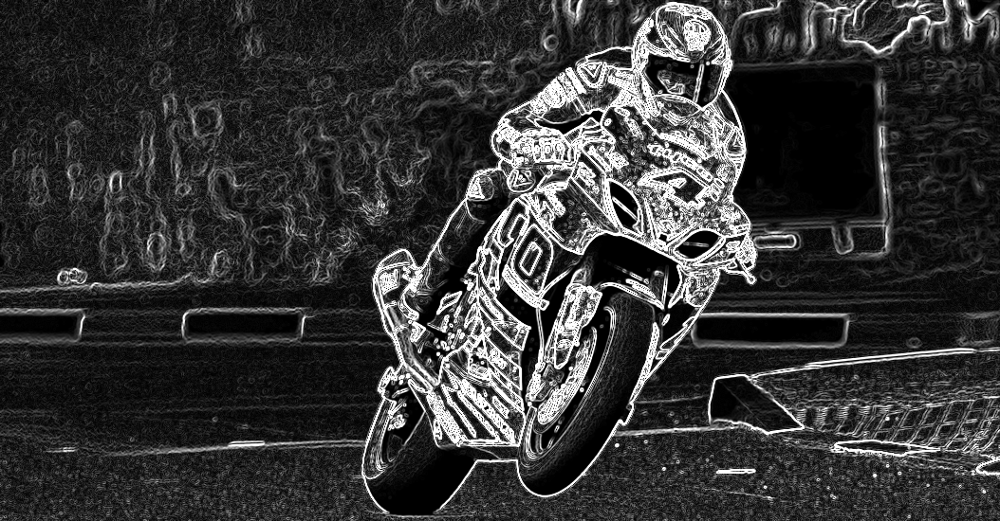

# CUDA Image Toolkit

Learning project exploring CUDA C++ for image processing, built after completing NVIDIA DLI's CUDA fundamentals course.

## Progress

- [x] Vector add (sanity check for CUDA pipeline)
- [x] Grayscale conversion
- [x] Box blur (shared memory)
- [x] Sobel edge detection
- [x] CPU vs GPU benchmarking

## Benchmark Results
Grayscale conversion, 1054x550 image, averaged over 100 runs:

| | Time | 
|---|---|
| CPU (single-threaded loop) | 9.000 ms |
| GPU (CUDA kernel only) | 0.038 ms |
| **Speedup** | **235.8x** |

*Note: GPU timing excludes host-device memory transfer to isolate compute performance. First-kernel-launch overhead (~20-30ms CUDA context init) is absorbed via a warmup call before timing.*

## Example Output
| Original | Grayscale | Blur | Edge Detection |
|---|---|---|---|
|  |  |  |  |

## Requirements

- NVIDIA GPU + CUDA Toolkit
- MSVC (Windows) or GCC (Linux)

## Build & Run Steps

- Use x64 Native Tools Command Prompt to run CUDA commands
- nvcc src/vector_add.cu -o vector_add.exe
  vector_add.exe

- nvcc src/grayscale.cu -o grayscale.exe
  grayscale.exe

- nvcc src/blur.cu -o blur.exe
  blur.exe
  
- nvcc src/edge_detect.cu -o edge_detect.exe
  edge_detect.exe

- nvcc src/benchmark.cu -o benchmark.exe
  benchmark.exe

## Example

Input → grayscale output using a custom CUDA kernel (2D thread indexing, one thread per pixel).
