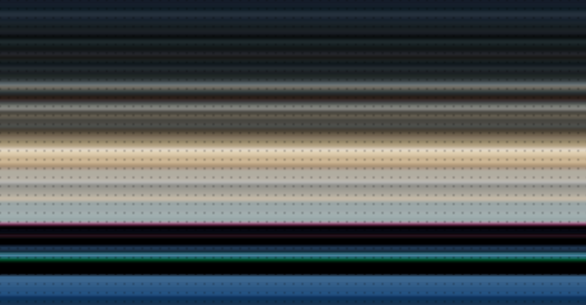

# CUDA Image Toolkit

Learning project exploring CUDA C++ for image processing, built after completing NVIDIA DLI's CUDA fundamentals course. Each program is a small, self-contained example of one core CUDA concept.

## Progress

- [x] Vector add (sanity check for CUDA pipeline)
- [x] Grayscale conversion (2D thread indexing)
- [x] Box blur (shared memory tiling)
- [x] Sobel edge detection
- [x] CPU vs GPU benchmarking (grayscale, blur, Sobel)
- [x] RGB blur (per-channel kernel launches)
- [x] RGB Sobel edge detection

## Example Output

| Original | Grayscale | Blur | Edge Detection |
|---|---|---|---|
|  |  |  |  |

| RGB Blur | RGB Edge Detection |
|---|---|
|  |  |

## Benchmark Results

Image: 1054x550. GPU times are kernel-only (excluding host-device memory transfer), averaged over 100 runs after a warmup launch. The CPU versions are plain single-threaded loops compiled with `/O2`.

| Kernel | CPU (ms) | GPU (ms) | Speedup |
|---|---|---|---|
| Grayscale | 1.000 | 0.022 | 45.9x |
| Box Blur (7x7) | 20.000 | 0.101 | 197.2x |
| Sobel Edge | 7.000 | 0.038 | 184.7x |

**What the numbers show:** the more work each pixel needs, the bigger the GPU advantage. Grayscale does 3 reads and a weighted sum per pixel. The 7x7 blur does 49 reads per pixel, which the CPU must process one pixel at a time, while the GPU spreads that work across thousands of cores.

**Methodology notes**
- The first CUDA kernel launch pays a one-time context-initialization cost (~20-30 ms). A warmup launch absorbs it. Without the warmup, my first benchmark showed the GPU as 5x *slower* than the CPU.
- My first benchmark compiled the CPU code without optimization, which inflated the speedups (blur showed 4331x). The numbers above use `/O2` for a fair baseline.
- CPU timing uses `clock()`, which has roughly 1 ms resolution on Windows, so the grayscale CPU figure is the least precise.
- Kernel-only timing isolates compute speed. End-to-end time for one small image would also include `cudaMemcpy` transfers, which can erase the GPU advantage. GPUs pay off on large, heavy, or repeated workloads such as video or batches.

## Requirements

- NVIDIA GPU + CUDA Toolkit
- Windows: MSVC (Visual Studio Build Tools, "Desktop development with C++"). Run commands from the **x64 Native Tools Command Prompt**.
- Image loading and saving use the single-header [stb](https://github.com/nothings/stb) libraries (included in `include/`)

## Build & Run

Run from the repository root. Run grayscale first, since blur and edge detection read `images/output_gray.png`.

```
nvcc -diag-suppress 550 src/vector_add.cu -o vector_add.exe
vector_add.exe

nvcc -diag-suppress 550 src/grayscale.cu -o grayscale.exe
grayscale.exe

nvcc -diag-suppress 550 src/blur.cu -o blur.exe
blur.exe

nvcc -diag-suppress 550 src/edge_detect.cu -o edge_detect.exe
edge_detect.exe

nvcc -diag-suppress 550 src/blur_rgb.cu -o blur_rgb.exe
blur_rgb.exe

nvcc -diag-suppress 550 src/edge_rgb.cu -o edge_rgb.exe
edge_rgb.exe

nvcc -O2 -Xcompiler "/O2" -diag-suppress 550 src/benchmark_all.cu -o benchmark_all.exe
benchmark_all.exe
```

`src/benchmark.cu` is the original grayscale-only benchmark. `src/benchmark_all.cu` extends it to blur and Sobel with CPU versions of each.

## How the RGB versions work

RGB images are stored interleaved in one flat array (`R,G,B,R,G,B,...`). To read one color of one pixel:

```
index = (y * width + x) * channels + channelIdx
```

where `channelIdx` is 0 for red, 1 for green, 2 for blue. The RGB kernels take `channelIdx` as a parameter and are launched once per channel, so the blur and Sobel logic is identical to the grayscale versions.

## What I Learned

- Thinking in parallel: one thread owns one unit of work (one pixel)
- Shared memory tiling with halo cells (including corners) to avoid repeated slow global-memory reads
- Always checking CUDA errors, and benchmarking GPU code honestly (warmup runs, averaging, a fair CPU baseline)
- How interleaved RGB data is laid out in memory

## Ideas for Next Steps

- Single-kernel RGB processing (all channels per thread)
- Tiled matrix multiplication compared against cuBLAS
- N-body particle simulation